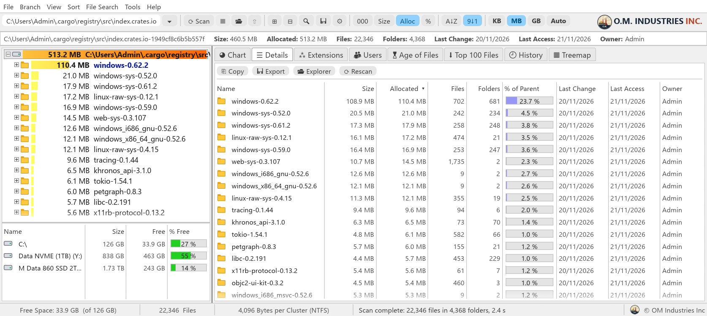

# OM Disk Analyzer Professional 2.0 — OM Industries Inc

See what is using space on your drives. OM Disk Analyzer scans a drive or folder and shows every
folder with its size and a size bar, biggest first, with charts, a treemap, file types, owners,
age of files, the 100 largest files and a history of earlier scans. You can open, export or
delete what you find.

## Features
* **Folder tree** with size bars: size, allocated space, file count or percent; KB/MB/GB/Auto
* **Drive list** with free space
* **Details** list of a folder's subfolders and files, sortable, with owners and dates
* **Chart**, **Treemap**, **Extensions**, **Users**, **Age of Files**, **Top 100 Files**, **History** tabs
* **Search** files by name or pattern and size
* **Multi-threaded scanning** (1 to 8 threads) and hard links counted once
* **Delete** folders and files (Recycle Bin or permanently) on Windows in administrator mode; to the Trash on a Mac
* Starts as **administrator** automatically for administrator accounts (optional)
* **Export to CSV** for Excel
* **File Explorer** right-click menu "Scan with OM Disk Analyzer" (Windows)
* **Windows and macOS** versions (Apple Silicon and Intel)
* **Setup** (per user, no admin rights) and a **portable** copy for USB sticks
* No account and no runtime to install; the only internet use is an optional check for a newer version

## Download / finished files (in `dist/`)
| File | Use it for |
|---|---|
| `OM Disk Analyzer 2.0.1 Setup.exe` | Installer: Start menu entry (desktop shortcut optional), uninstall from the Start menu or Settings > Apps. Replaces an installed 1.2. |
| `OM Disk Analyzer 2.0.1 Portable.zip` | Unzip anywhere; settings and history stay in its `Data` folder. |
| `OM Disk Analyzer 2.0.1 - source code.zip` | Source code, logos and documents. |
| `OM Disk Analyzer 2.0.1 macOS Apple Silicon.dmg` | Mac with an M1 or later chip: open, drag to Applications. |
| `OM Disk Analyzer 2.0.1 macOS Intel.dmg` | Mac with an Intel chip. |
| `OM Disk Analyzer 1.2 ...` | The earlier Python version (source in `python-version/`). |

Windows may warn about an unknown publisher until the files are signed: click
**More info > Run anyway**. On a Mac, right-click the app and choose **Open** the first time.
Releases are on the repository's **Releases** page, and the program tells you when a newer one is out.

## Documents
| Document | For |
|---|---|
| [User Guide](docs/USER_GUIDE.md) | Everything the program does, step by step, with shortcuts |
| [Installing and removing](docs/INSTALLING.md) | Setup, portable copy, uninstalling, updating |
| [Troubleshooting and FAQ](docs/TROUBLESHOOTING.md) | Common questions and fixes |
| [Privacy and security](docs/PRIVACY.md) | What it reads, stores and changes |
| [Code signing](docs/CODE_SIGNING.md) | Getting a certificate and signing the files |
| [Developer guide](docs/DEVELOPER_GUIDE.md) | Building, packaging, command line, how the code is organised |
| [Mac tester guide](docs/MAC_TESTER_GUIDE.md) | What to try and what to report on a Mac |
| [Mechanics sheet](MECHANICS.md) | Rules and defaults taken from the reference program's code |
| [Changelog](CHANGELOG.md) | What changed in each version |
| [License](LICENSE.md) | Terms of use |

## Quick start for developers
    cargo build --release                # target\release\om-disk-analyzer.exe
    cargo test
    .\tools\package.ps1                   # all finished files into dist\
    .\tools\package.ps1 -Pfx cert.pfx     # ...signed
    bash tools/build_mac.sh               # on a Mac: .app and .dmg for this chip

    # Publish: .\tools\Link_To_GitHub.ps1 once, then  git tag v2.0.1  and  git push origin v2.0.1
    # GitHub builds Windows and Mac and creates the release (.github/workflows/build.yml)

Requires Windows 10/11 or macOS 11+ and Rust from <https://rustup.rs>. See the
[Developer guide](docs/DEVELOPER_GUIDE.md).

---
© 2026 OM Industries Inc. All rights reserved.
