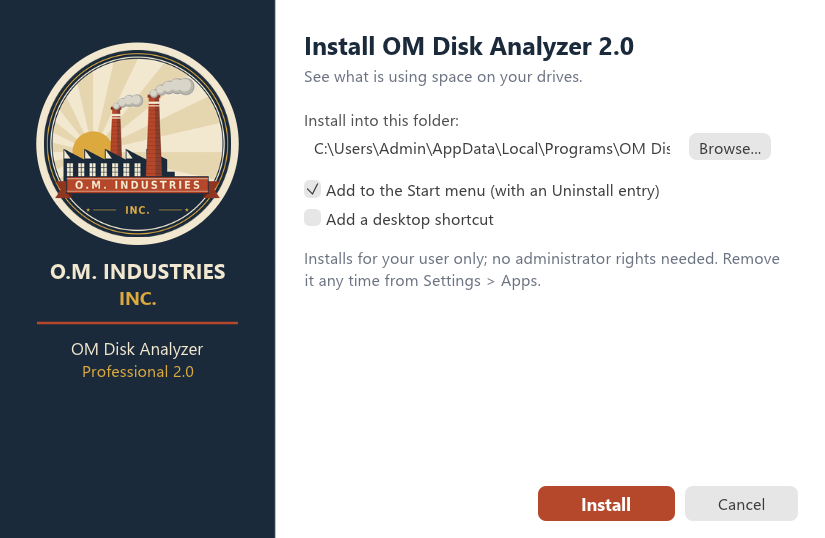

# Installing and removing OM Disk Analyzer 2.0.1

OM Disk Analyzer runs on **Windows 10 and Windows 11** (64-bit) and on **macOS 11 or later**
(Apple Silicon and Intel). It needs about 20 MB of disk space and nothing else: no .NET, Java or
other runtime. The Mac steps are in [Install on a Mac](#install-on-a-mac) below.

There are two ways to get it on Windows, both in the `dist` folder (Macs have their own files, see below):

| File | Choose it when |
|---|---|
| `OM Disk Analyzer 2.0.1 Setup.exe` | You want it in the Start menu and in Settings > Apps, like any other program. |
| `OM Disk Analyzer 2.0.1 Portable.zip` | You want to run it from a folder or USB stick without installing anything. |

## Install with Setup

1. Double-click **OM Disk Analyzer 2.0.1 Setup.exe**.
   * If Windows shows *"Windows protected your PC"*, click **More info**, then **Run anyway**.
     This appears because the file isn't code-signed yet (see [CODE_SIGNING.md](CODE_SIGNING.md)).
2. Check the folder (normally `C:\Users\<you>\AppData\Local\Programs\OM Disk Analyzer`) and choose
   whether to add a Start menu entry (on) and a desktop shortcut (off).
3. Click **Install**, then **Finish** (tick *Start OM Disk Analyzer now* to open it straight away).

Setup installs for **your user only** and needs **no administrator rights**. If version 1.2 was
installed, Setup replaces it in the same place, and your scan history is kept.

## Use the portable copy
1. Unzip **OM Disk Analyzer 2.0.1 Portable.zip** anywhere, for example onto a USB stick.
2. Open the folder and double-click **OM Disk Analyzer.exe**.

Its settings and scan history stay in the **Data** folder beside it, so nothing is written to the
computer it runs on. Keep the Data folder with the program.

## Install on a Mac
Choose the file for your Mac's chip (Apple menu > About This Mac: *Apple M…* means Apple Silicon,
*Intel* means Intel):

| File | Mac |
|---|---|
| `OM Disk Analyzer 2.0.1 macOS Apple Silicon.dmg` | M1, M2, M3, M4 and later |
| `OM Disk Analyzer 2.0.1 macOS Intel.dmg` | Intel Macs |

1. Open the `.dmg` and drag **OM Disk Analyzer** onto **Applications**.
2. The first time, **right-click** (or Control-click) the app in Applications and choose **Open**,
   then **Open** again. macOS asks this because the app isn't notarized by Apple yet; after that it
   opens normally. If macOS says it "can't be opened", go to **System Settings > Privacy &
   Security**, scroll down and click **Open Anyway**.
3. To see *everything* on the disk, give it **Full Disk Access**: System Settings > Privacy &
   Security > Full Disk Access, click **+**, choose OM Disk Analyzer, then restart it. Without it,
   macOS hides some folders (Mail, Messages, Safari ...) and they appear under *Show scan errors*.

On a Mac, **Delete** moves items to the **Trash** (you can put them back from there) and no
administrator mode is needed. Keyboard shortcuts use **⌘** where the menus say Ctrl. The File
Explorer menu and *Restart as administrator* are Windows-only and don't appear.
Settings and scan history are in `~/Library/Application Support/OM Industries Inc/OM Disk Analyzer`.
To remove the program, drag it from Applications to the Trash.

## Remove it
**Installed copy** (Windows), either way:
* **Start menu > OM Industries Inc > Uninstall OM Disk Analyzer**, or
* **Settings > Apps > Installed apps > OM Disk Analyzer > Uninstall**.

Tick *Also remove my settings and scan history* if you want those gone too, then **Remove** and
**Close**. The shortcuts, the Settings > Apps entry and the File Explorer menu entry are removed,
and the program's files are deleted a moment after the window closes.

**Portable copy:** close it and delete its folder.

## Updating
Run the new Setup over the old version; it updates the installed copy in place. Close
OM Disk Analyzer first, or Setup can't replace the program file.

## For administrators: silent and network use
* Setup and the program are the same file: a copy whose name contains "Setup", or the
  `--setup` option, opens the installer; `--uninstall` removes an installed copy.
* Installation is per user (`HKCU` uninstall key `OMDiskAnalyzer`, files under `%LOCALAPPDATA%`).
  For many PCs, copy the portable folder (the program inside it is `OM Disk Analyzer.exe`) to a shared or
  local folder instead.
