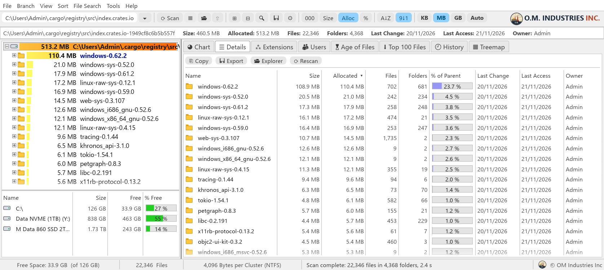
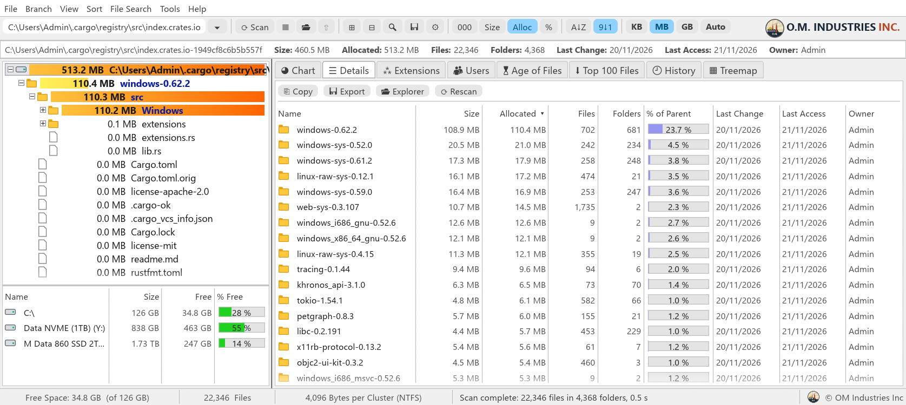
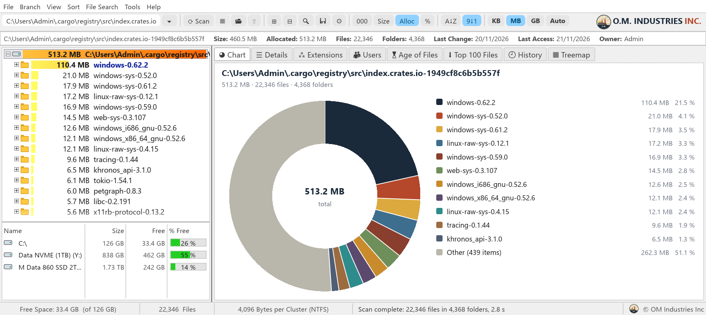
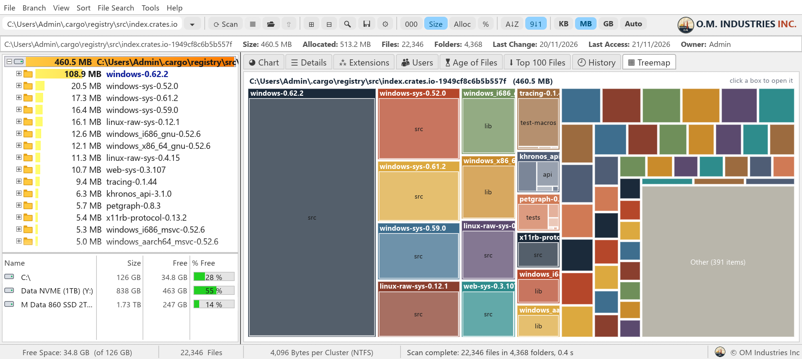
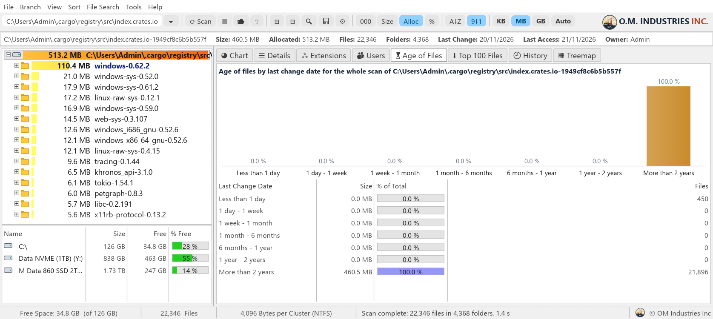
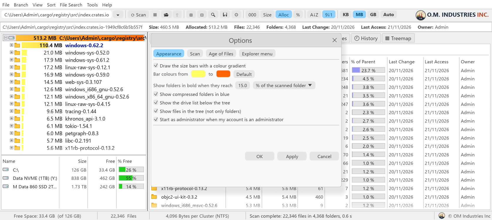

# OM Disk Analyzer 2.0 — User Guide

OM Disk Analyzer Professional, by OM Industries Inc, shows what is using the space on your drives:
which folders are biggest, which kinds of files fill them, who owns them, how old they are, and
which single files are largest. You can open, show in File Explorer, export or delete what you find.

## Contents
1. [Getting started](#getting-started)
2. [The main window](#the-main-window)
3. [The folder tree](#the-folder-tree)
4. [The tabs](#the-tabs)
5. [Toolbar and menus](#toolbar-and-menus)
6. [Deleting files and folders](#deleting-files-and-folders)
7. [Administrator mode](#administrator-mode)
8. [Searching for files](#searching-for-files)
9. [Exporting to Excel (CSV)](#exporting-to-excel-csv)
10. [Options](#options)
11. [File Explorer right-click menu](#file-explorer-right-click-menu)
12. [Keyboard shortcuts](#keyboard-shortcuts)
13. [Where settings are kept](#where-settings-are-kept)

---

## Getting started
1. Start **OM Disk Analyzer** from the Start menu (under *OM Industries Inc*), or double-click
   `OM Disk Analyzer.exe` in the portable folder. If your Windows account is an administrator,
   Windows asks for permission first (see [Administrator mode](#administrator-mode)).
2. Choose what to scan:
   * double-click a drive in the drive list at the bottom left, or
   * type a folder in the box at the top left and press **Enter**, or
   * click **📂** (or press **Ctrl+O**) to pick a folder.
3. While it scans, the status bar counts files and folders. When it finishes, the tree shows
   every folder with its size, biggest first.

Scanning a whole drive with hundreds of thousands of files takes from a few seconds to a few
minutes. Press **Esc** or **■** to stop early.

## The main window
| Part | What it shows |
|---|---|
| **Path box and toolbar** (top) | The folder being looked at, and the buttons described below. The OM Industries logo sits on the right. |
| **Information bar** | For the selected folder or file: size, allocated space, number of files and folders, last change, last access and owner. |
| **Folder tree** (left) | Every scanned folder with a size bar. |
| **Drive list** (bottom left) | Each drive with its size, free space and a green bar for % free. Double-click one to scan it. |
| **Tabs** (right) | Details, charts and statistics for the selected folder or the whole scan. |
| **Status bar** (bottom) | Free space on the drive, number of files, the drive's cluster size, and messages. |

## The folder tree
* Each line shows a **size** and a **name**, with a yellow-to-orange **bar** showing the
  folder's share of the folder above it. The top line is the scanned folder itself (100 %).
* Folders that take at least **15 % of the scanned folder** are shown in **bold blue**
  (change this in Options).
* **Blue names** are compressed folders. **Red names** and a folder icon with **!** could not be
  read (often protected system folders; try [administrator mode](#administrator-mode)).
* **[Files]** is the total of the files that sit directly in a folder next to its subfolders.
* Click **⊞** (or double-click the line, or press **→**) to open a folder; **⊟** / **←** closes it.
* To see each single file in the tree, turn on **View > Show files in tree**.
* Right-click a line for **Open**, **Show in Explorer**, **Copy path**, **Expand two levels**,
  **Scan this branch** and **Delete...**.
* Rest the pointer on a line for a summary.

What the size column shows is chosen on the toolbar:

| Button | Shows |
|---|---|
| **000** | number of files |
| **Size** | the files' real size |
| **Alloc** | the space they take on the disk (whole clusters), the default |
| **%** | percent of the folder above |

**KB / MB / GB / Auto** choose the unit. **A↓Z** sorts by name, **9↓1** by size.

## The tabs
| Tab | What it shows |
|---|---|
| **Chart** | A ring chart of the selected folder's biggest subfolders (and its [Files]). Click a slice or a legend line to open that folder. |
| **Details** | A list of the selected folder's subfolders and files with size, allocated space, files, folders, % of parent, last change, last access and owner. Click a column header to sort; double-click a folder to open it in the tree. Right-click for Open, Show in Explorer, Copy path and Delete. **Copy** puts the list on the clipboard. |
| **Extensions** | Which file types (.mp4, .zip, .exe ...) use the most space in the whole scan. |
| **Users** | Which Windows users own the space (turn on *owner statistics* in Options to count every file exactly). |
| **Age of Files** | How much is less than a day, a week, a month, 6 months, a year, 2 years or more than 2 years old (by last change date; changeable in Options). |
| **Top 100 Files** | The 100 largest files in the scan. Double-click one to show it in File Explorer; right-click to delete. |
| **History** | Every finished scan with date, size and the change since the previous scan of the same folder, so you can see folders grow. Double-click to scan again. |
| **Treemap** | Boxes sized by space used, two levels deep. Click a box to open that folder. |

## Toolbar and menus
| Button | Menu | Does |
|---|---|---|
| ⟳ Scan | File > Scan / Refresh (F5) | Scan the folder in the path box again |
| ■ | File > Stop scan (Esc) | Stop the running scan |
| 📂 | File > Select directory (Ctrl+O) | Pick a folder to scan |
| ⇧ | Branch > Up one level (Backspace) | Go to the folder above (scanning it if needed) |
| ⊞ / ⊟ | Branch > Expand two levels / Collapse all | Open or close the tree |
| 🔍 | File Search > Search files by name (Ctrl+F) | Find files in the scan |
| 💾 | File > Export to CSV (Ctrl+E) | Save the tree as a spreadsheet |
| ⚙ | Tools > Options | Settings |
| ⏷ | — | Drives and recently scanned folders |

Other menu items: **File > Restart as administrator**, **Tools > Clear scan history**,
**Tools > Show scan errors**, **Tools > Explorer context menu**, **Help > Check for updates**, **Help > About**.

## Deleting files and folders
1. Right-click a folder or file in the tree (or a row in **Details** or **Top 100 Files**) and
   choose **🗑 Delete...**, or select it and press **Del**.
2. A window shows what will be deleted and how big it is. Choose:
   * **Move to Recycle Bin** — can be restored from the Recycle Bin, or
   * **Delete permanently** — cannot be undone.
3. The tree and totals update straight away; there is no need to scan again.

Deleting is available in **administrator mode** only. In normal mode the window offers
**Restart as administrator** instead. The scanned top folder itself can't be deleted from the tree.

> ⚠ Administrator mode can delete protected Windows and program files. Only delete what you
> recognise. Prefer the Recycle Bin.

## Administrator mode
If your Windows account is an administrator, OM Disk Analyzer starts with administrator rights:
Windows asks *"Do you want to allow this app to make changes?"* each time it opens.
* Choose **Yes** to run as administrator: protected folders can be scanned and anything can be
  deleted. The title bar says **(Administrator)**.
* Choose **No** to run normally; everything except deleting works.

Accounts that are not administrators always start normally. To stop being asked, turn off
**Options > Appearance > Start as administrator when my account is an administrator**.
You can still use **File > Restart as administrator** when you need it.

## Searching for files
**File Search > Search files by name** (Ctrl+F) looks through the scanned folders.
Type part of a name (`report`) or a pattern (`*.iso`, `IMG_????.jpg`) and, if you like, a
minimum size in MB, then press **Search**. Double-click a result to show it in File Explorer.

## Exporting to Excel (CSV)
**File > Export to CSV** (Ctrl+E) saves every scanned folder as a CSV file that Excel opens directly:
path, name, level, size and allocated space in bytes, files, folders, % of parent, last change and
last access.

## Options
**Tools > Options** has four pages:

| Page | Settings |
|---|---|
| **Appearance** | Gradient bars and their two colours; when folder names are bold (% of the scanned folder, % of the parent folder, or MB); blue for compressed folders; the drive list; files in the tree; start as administrator. |
| **Scan** | Follow symbolic links and junctions; statistics on file extensions; owner statistics for every file (slower); folders to skip and files to count (patterns with `*` and `?`, separated by `;`); scan priority; **scanning threads** (automatic, or 1 to 8: more threads scan big drives faster, especially on SSDs; following links always uses one); **count files with several names (hard links) only once** (on by default on a Mac; off by default on Windows because it makes scans slower). |
| **Age of Files** | Which date to group by (last access, last change, creation) and the age limits in days (default 1, 7, 30, 182, 365, 730). Takes effect with the next scan. |
| **Explorer menu** | Add or remove *Scan with OM Disk Analyzer* in File Explorer's right-click menu. |

## File Explorer right-click menu
Turn it on in **Options > Explorer menu**. Then right-click any folder or drive in File Explorer
and choose **Scan with OM Disk Analyzer** (on Windows 11 it's under *Show more options*). It is
added for your user only and removed again by the uninstaller.

## Keyboard shortcuts
On a Mac, use ⌘ where this table says Ctrl.

| Keys | Does |
|---|---|
| F5 | Scan / refresh |
| Esc | Stop the scan; close the Delete window |
| Ctrl+O | Select a folder |
| Ctrl+F | Search files |
| Ctrl+E | Export to CSV |
| Ctrl+Plus / Ctrl+Minus | Expand two levels / collapse all |
| ↑ ↓ PgUp PgDn Home End | Move in the tree |
| → / ← | Open / close a folder (← again goes to the folder above) |
| Enter | Open or close the selected folder |
| Backspace | Up one level |
| Del | Delete the selected folder or file |

## Where settings are kept
* **Mac:** `~/Library/Application Support/OM Industries Inc/OM Disk Analyzer`. On a Mac, Delete
  moves items to the Trash, Ctrl shortcuts are **⌘**, and the Explorer menu and administrator
  mode don't apply.
* **Installed copy:** `%APPDATA%\OM Industries Inc\OM Disk Analyzer` — `settings-v3.json`
  (settings) and `history.json` (scan history, shared with version 1.2).
* **Portable copy:** the `Data` folder next to `OM Disk Analyzer.exe`.

Deleting these files resets the settings and history.
